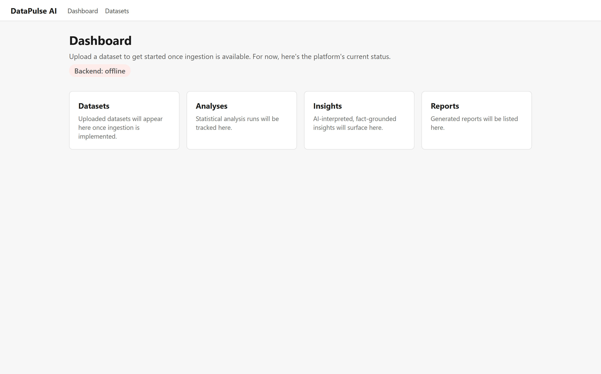
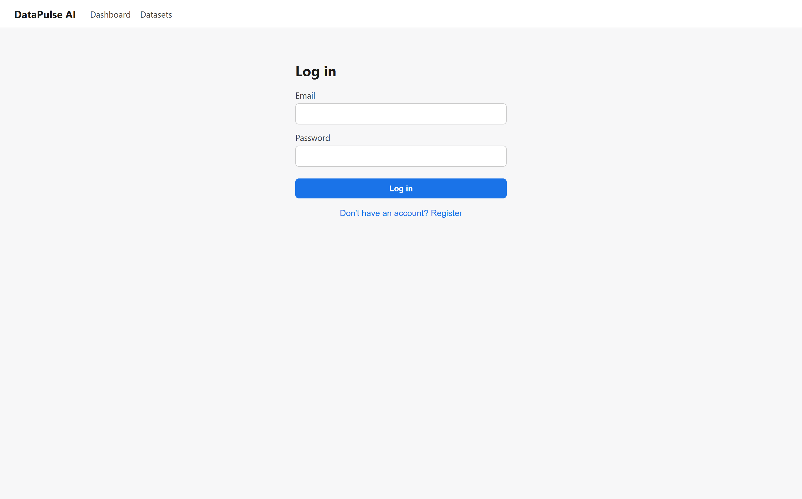
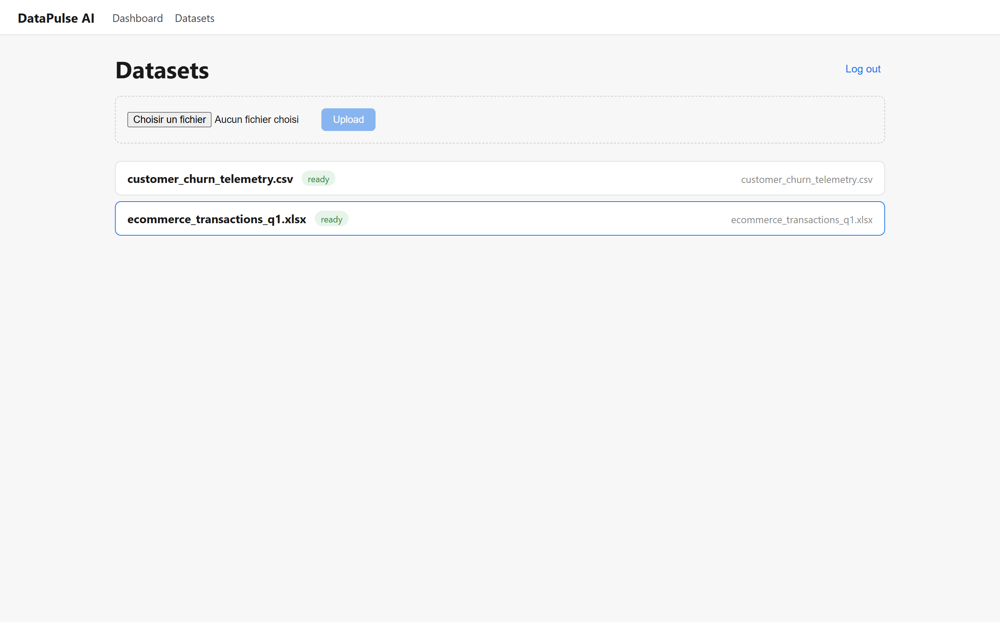
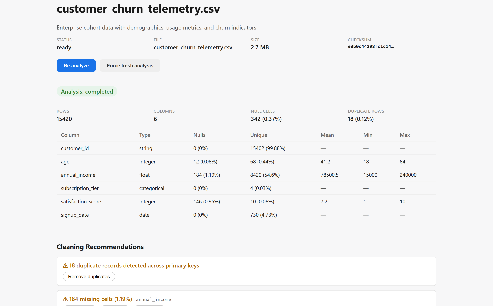
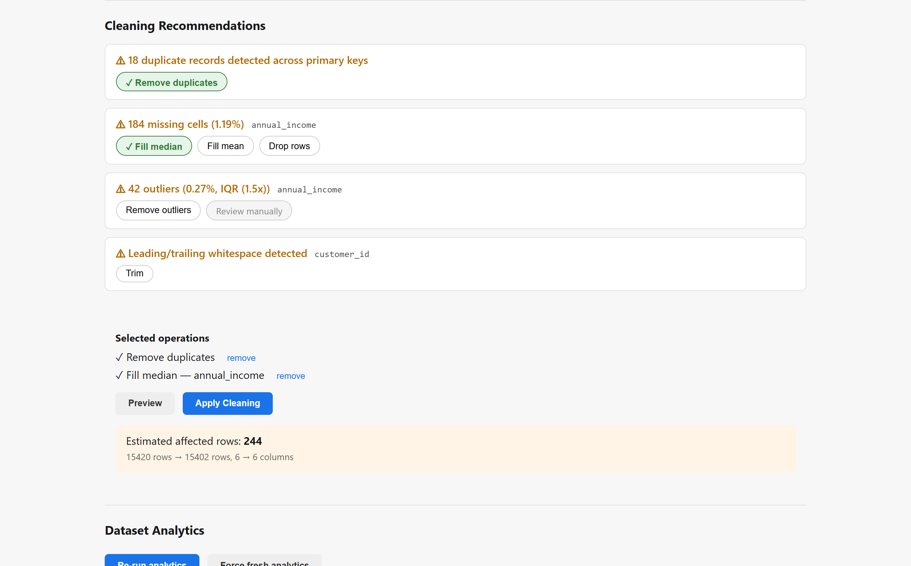
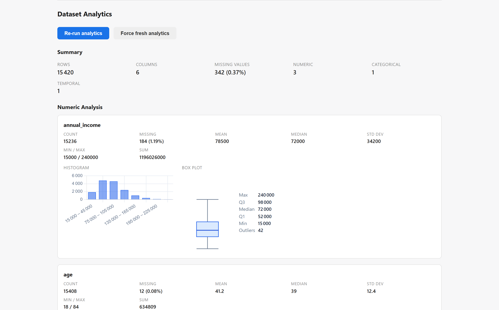

# DataPulse AI

An AI-powered data analytics platform. Users upload tabular datasets (CSV, XLSX, JSON) and the platform turns them into deterministic, structured business intelligence — profiling, cleaning, statistics, anomaly detection, and visualizations — which an AI layer then interprets and explains in natural language. The AI never performs the analysis itself; it only reasons over structured, computed results, and every number a user sees traces back to an actual computation.

This is not a chatbot wrapper. It's a real data-processing pipeline with an AI layer on top.

```
Dataset
  -> ingestion
  -> validation
  -> profiling
  -> cleaning & transformation
  -> statistical analysis & analytics
  -> correlation & scatter plots
  -> visualization data
  -> structured insights
  -> AI interpretation
  -> natural-language questions
  -> report
```

## Stack

| Service       | Stack                                                     |
|---------------|-----------------------------------------------------------|
| `frontend`    | Angular 22, TypeScript, Chart.js                          |
| `backend`     | Symfony 8, PHP 8.4, Doctrine ORM, PostgreSQL, JWT, PHPStan |
| `data-engine` | Python 3.12+, FastAPI, Pandas, NumPy, SciPy, Ruff, Mypy   |

Full architecture, service responsibilities, and inter-service communication: [`docs/architecture.md`](docs/architecture.md).

## Repository layout

```
datapulse-ai/
├── frontend/         Angular 22 app with Chart.js visualizations
├── backend/          Symfony 8 API orchestration layer
├── data-engine/      FastAPI data processing and analytics service
├── infrastructure/   Cross-cutting deployment config (nginx, etc.)
├── docs/             Architecture, profiling, cleaning, analytics contracts
├── .github/          CI workflows (testing, linting, static analysis)
├── docker-compose.yml
└── README.md
```

## Quick start

```bash
cp .env.example .env
docker compose up --build
```

| Service     | URL                                |
|-------------|---------------------------------------|
| Frontend    | http://localhost:4210                 |
| Backend API | http://localhost:8020/api/health      |
| Data engine | http://localhost:8021/health          |
| PostgreSQL  | localhost:5434                        |

After the stack is up, apply database migrations once:

```bash
docker compose exec backend php bin/console doctrine:migrations:migrate --no-interaction
```

Full setup (including running each service natively without Docker), environment variables, and Docker command reference: [`docs/development.md`](docs/development.md).

## Interface & Aperçu visuel

Voici un tour d'horizon des interfaces clés de la plateforme DataPulse AI :

### 1. Tableau de bord & Présentation du système
Vue d'accueil guidant l'utilisateur sur le flux d'analyse et les capacités de la plateforme.


---

### 2. Authentification sécurisée (JWT)
Connexion et enregistrement avec validation stricte, stockage sécurisé du token et retours d'erreurs en temps réel.


---

### 3. Gestion et Ingestion des Datasets
Catalogue des jeux de données téléversés, zone de dépôt (CSV, XLSX, JSON), badge de sécurité contre l'injection de formules et formatage intelligent des tailles de fichiers (`FileSizePipe`).


---

### 4. Data Profiling & Analyse des colonnes
Calcul déterministe en un clic : détection des types métiers (integer, float, categorical, date...), volumétrie, complétude, cellules nulles, unicité et statistiques de dispersion (min, max, moyenne).


---

### 5. Recommandations de nettoyage & Prévisualisation interactive
Détection proactive d'anomalies (doublons, valeurs manquantes, espaces parasites, outliers IQR). L'utilisateur sélectionne ses opérations et lance un calcul de prévisualisation (avant/après) avant d'appliquer les transformations de manière non destructive.


---

### 6. Analytics avancés & Visualisations interactives (Chart.js)
Génération automatisée d'analyses statistiques approfondies : histogrammes avec pas optimisés, boxplots SVG de distribution, graphiques catégoriels en barres, séries chronologiques agrégées par granularité, matrices de corrélation de Pearson et nuages de points relationnels échantillonnés.


---

## Development phases

This project is built incrementally, one phase at a time, never skipping ahead:

1. ✅ **Foundation** — monorepo scaffolding, health checks, Docker Compose, domain schema
2. ✅ **Data ingestion** — JWT auth, secure file upload, validation, untrusted-input protections
3. ✅ **Data profiling** — deterministic type detection, column statistics, IQR outliers, quality metrics
4. ✅ **Data cleaning** — automated recommendations, dry-run preview, non-destructive versioning
5. ✅ **Data analytics & visualization** — numeric distributions, boxplots, correlations, time series, Chart.js
6. ✅ **AI analyst** — automated executive narrative, hygiene health score, categorized insights (facts, interpretations, recommendations), zero-fabrication grounded Q&A
7. ⏳ **Professional UI** — complete design system, dark mode, responsive dashboards *(next)*
8. ⏳ **Production readiness** — security hardening, E2E tests, metrics, deployment

## Data principles

- The original uploaded dataset is never modified. Cleaning produces a separate, traceable `DatasetVersion` — never an in-place edit.
- No analytical result is ever fabricated. Every number shown to a user originates from an actual computation over the dataset.
- If a dataset doesn't contain enough information to answer a question, the platform says so instead of guessing.
- Insights are explicitly tagged as a `computed_fact`, a `statistical_interpretation`, or a `recommendation` — never presented as if they were the same kind of claim.
- Uploaded files are treated as untrusted input. Path traversal, decompression bombs, oversized files, memory exhaustion, CSV injection, and malicious spreadsheet content are all actively guarded against — see [`docs/architecture.md`](docs/architecture.md#dataset-ingestion-phase-2) for the full pipeline.

## Quality & Tests

```bash
# Backend (PHPUnit + PHPStan static analysis)
cd backend && vendor/bin/phpstan analyse --no-progress
cd backend && php bin/phpunit

# Data engine (pytest + ruff linter + mypy type checker)
cd data-engine && ruff check .
cd data-engine && mypy app/
cd data-engine && pytest

# Frontend (Vitest unit tests + ESLint)
cd frontend && npm run lint
cd frontend && npx ng test --watch=false
```

All quality checks and tests run automatically in CI on every push/PR ([`.github/workflows/ci.yml`](.github/workflows/ci.yml)).

## Status

**Phases 1 through 6 complete.** 
- **Profiling (Phase 3):** Deterministic type detection, null/unique/duplicate statistics, IQR outliers. Full contract: [`docs/data-profiling.md`](docs/data-profiling.md).
- **Cleaning (Phase 4):** Issue detection, actionable recommendations, before/after preview, reproducible operation pipelines, non-destructive version creation. Full contract: [`docs/data-cleaning.md`](docs/data-cleaning.md).
- **Analytics & Visualization (Phase 5):** Numeric distributions (mean, median, std dev, min/max, sum), histogram binning, SVG-styled boxplots, categorical bar charts, temporal aggregation (day/week/month/year), Pearson correlation matrices, downsampled scatter relationships. Full contract: [`docs/data-analytics.md`](docs/data-analytics.md).
- **AI Analyst (Phase 6):** Executive summary narrative, dataset health scoring (0-100), structured insight cards with kind categorization (`computed_fact`, `statistical_interpretation`, `recommendation`), and interactive grounded Q&A with zero hallucination. Full contract: [`docs/ai-analyst.md`](docs/ai-analyst.md).
- **Architecture & Quality:** Component-based UI architecture, global toast notifications, strict linting (ESLint, Ruff), static type checking (PHPStan level 5, Mypy), automated CI pipeline.
